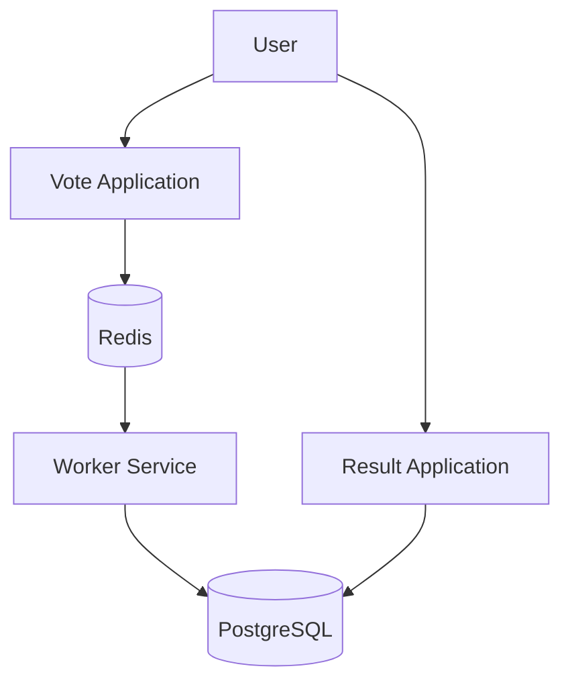
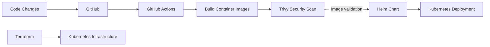

# Voting App — DevOps Capstone

A containerized voting application used to practise and demonstrate DevOps workflows, including Docker, Kubernetes, Helm, Terraform, and GitHub Actions.

The project extends the example voting application with infrastructure-as-code, CI/CD automation, and container security checks.

## Overview

The application consists of five main components:

- **Vote:** Interface for submitting votes.
- **Result:** Interface for viewing voting results.
- **Worker:** Processes votes and updates the database.
- **Redis:** Temporarily stores submitted votes.
- **PostgreSQL:** Stores processed voting data.

The goal of this project is to explore how an application can be containerized, tested, scanned, and prepared for deployment using modern DevOps tools.

## Architecture

### Application architecture



### DevOps workflow



The diagrams describe the intended application and DevOps workflow; they do not indicate that the application is currently running on AWS.

## Technology Stack

| Technology | Purpose |
|---|---|
| Docker | Containerization |
| Docker Compose | Local multi-container environment |
| Kubernetes | Container orchestration |
| Helm | Kubernetes application packaging and deployment configuration |
| Terraform | Infrastructure as Code |
| AWS EKS | Intended managed Kubernetes environment |
| GitHub Actions | CI/CD automation |
| Trivy | Container image vulnerability scanning |
| Redis | Vote queue |
| PostgreSQL | Persistent data storage |

## Run Locally

### Prerequisites

- Docker
- Docker Compose

### Start the application

Clone the repository and enter the project directory:

```bash
git clone https://github.com/sub-glitch/example-voting-app.git
cd example-voting-app
```

Start the application:

```bash
docker compose up --build
```

Once the containers have started, open:

- **Voting application:** http://localhost:8080
- **Results application:** http://localhost:8081

To stop the application:

```bash
docker compose down
```

To stop the application and remove its Compose-managed volumes, if you also want to remove local persisted data:

```bash
docker compose down -v
```

## CI/CD and Container Security

The repository includes GitHub Actions workflows and container security measures intended to support a repeatable delivery process.

Security considerations include:

- Pinning base images to specific versions rather than using `latest`.
- Running application containers as a non-root user where configured.
- Using `.dockerignore` to exclude unnecessary files from build contexts.
- Integrating Trivy image vulnerability scanning into the CI workflow.
- Keeping credentials and secrets out of source control.

Workflow success and deployment status should be verified from the repository's GitHub Actions runs.

## Infrastructure as Code

The `terraform/` directory contains Terraform configuration for the AWS infrastructure planned for this project.

The infrastructure work includes:

- Amazon EKS cluster configuration.
- IAM roles and permissions for GitHub Actions.
- OpenID Connect (OIDC) configuration for workload identity.
- Supporting networking and security resources.
- Infrastructure outputs for accessing the cluster.

The Terraform configuration is retained in the repository so the infrastructure can be reviewed, improved, and redeployed when the environment and budget permit.

## Kubernetes and Helm

The `helm/voting/` directory contains the Helm chart for configuring the voting application on Kubernetes.

The repository also contains Kubernetes-related manifests and supporting configuration.

These files demonstrate the intended deployment approach, but a successful end-to-end deployment should be confirmed independently before treating the application as running in a Kubernetes environment.

## AWS Deployment Status

An AWS EKS deployment was attempted in the `eu-west-1` region.

The EKS control plane reached the `ACTIVE` state, but the managed node groups failed to launch because the configured `t3.large` instances were not eligible for the account's Free Tier.

As a result, the complete application deployment was **not successfully completed on AWS**.

The Terraform and Kubernetes configurations remain available for further testing and deployment. AWS resources should be checked and cleaned up after experiments to avoid unnecessary charges.

## Project Structure

```text
example-voting-app/
├── .github/          # GitHub Actions workflows
├── docs/             # Project documentation
├── helm/
│   └── voting/       # Helm chart
├── terraform/        # Infrastructure as Code
├── scripts/          # Supporting scripts
├── vote/             # Voting application
├── result/           # Results application
├── worker/           # Vote processing service
├── docker-compose.yml
└── README.md
```

## Key Learnings

This project provided practical experience with:

- Building and running multi-container applications.
- Understanding service communication and application dependencies.
- Working with Kubernetes deployment configuration and Helm.
- Defining cloud infrastructure with Terraform.
- Integrating GitHub Actions into a DevOps workflow.
- Adding vulnerability scanning to container workflows.
- Troubleshooting cloud deployment failures and understanding infrastructure costs.

## Project Status

**Status:** DevOps capstone — implementation and deployment configuration in progress.

The application, infrastructure code, and delivery configuration are maintained in the repository. The AWS deployment remains incomplete because the configured worker instance type was not eligible for the account's Free Tier.

## Repository

[View the project on GitHub](https://github.com/sub-glitch/example-voting-app)
